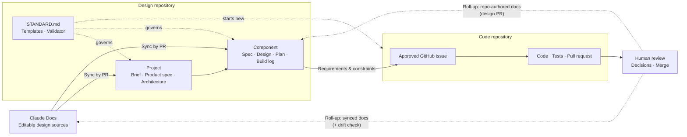

# Design

The design docs for everything Justin builds: one folder per project, written while the
work is being built rather than reconstructed afterward. Code repositories don't keep
design docs; they read them from here.

## Projects

| Project | Folder | What it is |
| --- | --- | --- |
| Construction OS | [construction-os/](construction-os/) | A company-specific AI system for residential builders. Components: the [corpus](construction-os/corpus/) — the company's governed knowledge — the [document workbench](construction-os/document-workbench/) — retrieval, pricing and drafting — and the [intake router](construction-os/intake-router/), which classifies inbound messages and routes them to a workflow. |
| Agents | [agents/](agents/) | Small agents built to learn how agent loops work, starting with a job evaluator. Component: the job evaluator. Code in [`agents`](https://github.com/justinyurasits/agents). |
| Construction OS demos | [construction-os-demos/](construction-os-demos/) | Standalone tools in the same domain: Fieldscope (subcontractor safety compliance) and the PCO Generator (live at draftconstructionchangeorder.com). |

Visual design (colors, type, marks, components) is the one exception. It lives in
[`brand-system`](https://github.com/justinyurasits/brand-system), and design docs that
need a visual rule point there.

## How it works

**1. A project is a folder; a component is a subfolder.** Every component has the same
files from the day it's created: README, brief, spec, design, plan, build log, sync
manifest, images. A project adds a brief and, as it grows, principles, a product spec and
an architecture doc. Every file has one job.

**2. Docs are written in Claude Docs or here.** Most are drafted in a Claude Doc and
synced into this repo by pull request, so the history shows what changed and when. The
Claude Doc is the working copy; the file here is the reviewed record and is never edited
by hand. A few docs, like the agents docs, are written here directly, also by pull
request.

**3. Code repos read from here.** Each code repository's `CLAUDE.md` points Claude Code
at its project and component folder and says what to read first. Design leads, code
follows: a change to what the product does is made here (or in its Claude Doc) first,
and the code pull request cites it.

**4. Work runs through GitHub.** The issue is the plan. Each pull request records the
small decisions made while coding and what the work taught. Every so often, Claude Code
asks to roll those up into the component's design log and build log, and checks whether
any Claude Doc has moved ahead of its synced copy. Nothing enters the record without
Justin's approval.

**5. The structure is checked.** `python tools/validate.py` runs on every pull request
and fails if a project or component is missing a file or a sync record is wrong.

The rules behind all of this are in [STANDARD.md](STANDARD.md). Where this page and the standard differ, the standard is right.

## The files at the top

| File | Its one job |
| --- | --- |
| `README.md` | This page: what the repo is and how it works. |
| [`STANDARD.md`](STANDARD.md) | The rulebook. Every file type and its job, naming, front matter, and the rules for how design and code work together. When this page and the standard differ, the standard is right. |
| [`CLAUDE.md`](CLAUDE.md) | Instructions for Claude Code working in this repository. |
| [`DOCS.md`](DOCS.md) | An index of every synced doc: its Claude Doc link, where it syncs to, revision and date. Rebuilt from the manifests by `python tools/build_docs.py`; never edited by hand. |
| `sync-manifest.yaml` | The sync record for the files at the top (today, `STANDARD.md`). Every folder with synced files has one. |
| [`_template/`](_template/) | The standard as files: `project/`, `component/`, and `repo/` (what every code repository starts with). |
| `tools/validate.py` | The structure check. |
| `tools/build_docs.py` | Rebuilds DOCS.md from the sync manifests. Run it after any sync. |

## Adding something

- **A project:** copy `_template/project/`, rename it, fill it in, and add a row to the
  table above.
- **A component:** copy `_template/component/` into the project and list it in the
  project README.
- **A code repository:** copy `_template/repo/` into it and fill in section 7 of its
  `CLAUDE.md`.

Every change is a branch and a pull request. Never commit to main.
