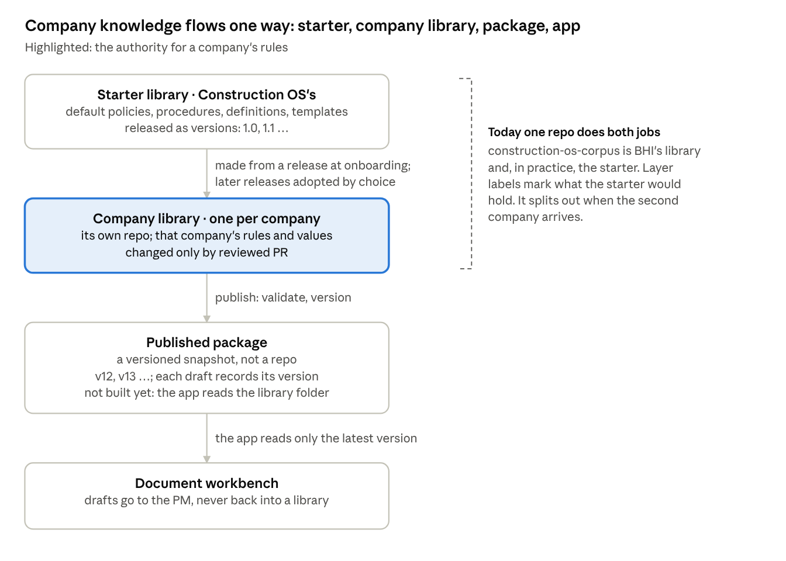
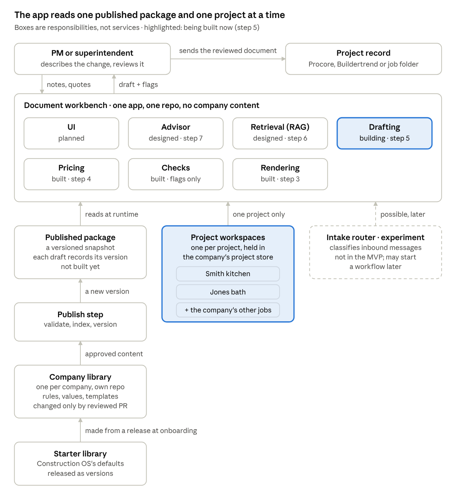

> **Synced from Claude Docs. Edit there, not here.**
> Source: [Construction OS — Architecture](https://claude.ai/artifact/6UZv2djagWrjbm4AM7MXt9) · doc revision 27 · synced 2026-11-09

# Construction OS — Architecture

Nov 8, 2026 · @Justin

Construction OS is one product. A PM or superintendent describes what happened on a job and gets back the company's rules for it and a draft of the document it calls for, priced and in the company's format. The first slice is the priced potential change order.

- **Who it's for:** residential builders of about $25M to $250M, and their PMs and superintendents (Product Brief).
- **Where it sits:** upstream of Procore and Buildertrend, which stay the project record. Construction OS keeps no project records.
- **What it produces:** drafts. A person reviews everything before it goes anywhere.

This page is the product's map: its parts, what crosses between them, what's authoritative, and what's built. Each part's own design docs hold the detail. Product-level decisions are logged here; a part's own decisions stay in that part's design doc.

## Terms

| Term | Means |
| --- | --- |
| Starter library | Construction OS's own content: the default policies, procedures, definitions and templates a new company starts from. Owned by Construction OS as the vendor. Not yet split out from BHI's library. |
| Company library | One company's copy of the library, made from a starter release and customized at onboarding. The authority for that company's rules. Each company's lives in its own repo; BHI's is construction-os-corpus. |
| Published package | A validated, versioned snapshot of one company library, which is what the app reads. A build, not a repo. Not built yet. |
| Project | The construction job, such as one client's kitchen renovation. Not a Claude Project. Whether to call it "job" instead is open. |
| Project context | What a PM supplies for one project (notes, quotes, the executed contract) and the drafts made from it. It is kept in that project's workspace and reused across the project's work (decided Nov 8). Working files, not the project record. |
| Draft | A generated document for a person to review: the Word file, its flags, and its manifest. |
| Project record | The authoritative history of a job, kept in Procore, Buildertrend or the company's job folder. Construction OS never keeps it. |

## How it works

Three things happen, at three speeds. A company is onboarded once, its PMs draft documents every day, and its library changes now and then.

### Onboarding a company (once)

Onboarding turns the starter library into the company's own library, then publishes it.

1. **Start the company's library from the current starter release.** It gets its own repo, and the release it came from is recorded.
2. **Extract from the company's own records.** This means its last 30 to 50 contracts and change orders, its contract forms, and any procedures it already has. Rate tables and pricing come from this. Extraction proposes; nothing is adopted without the Policy Owner.
3. **Set up the company profile:** name, licenses, signatory, letterhead and brand kit, and which person fills each role (Executive, Project Manager, Superintendent, Accounting).
4. **Settle the configuration.** Every registry item takes the company's value or keeps the default. Questions are asked only where extraction found nothing.
5. **The Policy Owner confirms the result.**
6. **Run the company acceptance suite.** It checks that every decision is answered, that no value breaks a locked rule, and that the test documents come out right with the company's values. The Policy Owner signs the readiness report.
7. **Publish package version 1 and create the company's project store.** The company is live.

None of this is tooling yet. BHI's library was built by hand, and steps 2 and 6 are designed but not built (System Design, sections 5 and 6.2). Onboarding is founder-led at first.

### Drafting on a project (every day)

1. **The PM opens the project,** or names a new one. Its workspace is created on first use, with nothing else to fill in.
2. **The PM adds what they have:** notes, a subcontractor's quote, and the executed contract the first time.
3. **The PM asks for advice or a draft.** The app reads the company's latest package and that one project's files.
4. **Drafting proposes the scope and quantities.** Pricing does the numbers, checks flag the gaps, and rendering produces the Word file.
5. **The PM reviews and fixes the draft,** sends it, and files it in the project record.
6. **The draft is saved to the project,** so the next document on that job starts from what's already there.

### Changing the library (as needed)

- **A company change,** such as a new overhead rate or a different procedure, goes in as a reviewed PR to its library and is published as a new version. Later drafts use it; earlier drafts still show the version they used.
- **A starter release,** such as a fixed clause or a change in the law, is reviewed by each company, which adopts what applies and publishes.

## How company knowledge flows

Company knowledge moves one way. It goes from the starter library into a company's library at onboarding, then from that library into a published package each time the library changes. Drafts never flow back.

*Static export of the diagram in the [Claude Doc](https://claude.ai/artifact/6UZv2djagWrjbm4AM7MXt9), taken 2026-11-09.*

1. **Construction OS keeps the starter library** and puts out releases: 1.0, then 1.1 when a clause is fixed or a law changes.
2. **Onboarding creates the company's library from a starter release,** then customizes it. Values come from the company's own bids and contracts, and the company profile holds its identity. The company keeps its own contract forms where it has them and its own procedures where it works differently. The Policy Owner confirms the result.
3. **The company changes its library through reviewed PRs,** like every change to BHI's today.
4. **Each approved change is published as a new package version.** The app reads only the latest. Every draft records the version it used.
5. **Starter releases reach companies by choice.** Each company reviews a new release and adopts what applies, because its copy may differ on purpose. Nothing merges automatically.

**Example.** The Policy Owner raises overhead from 10% to 12%. The PR merges and publishing makes package v13. Drafts from then on use 12% and say v13. Last week's PCO still says v12, which explains its 10%.

**Open questions:**

- How a company reviews and adopts a starter release. Today it's one sentence, not a design.
- Whether every company starts from the starter. A company with its own contract forms and procedures may take only parts of it.
- When the starter splits out of BHI's library. Too late, and BHI's own choices ship to every customer as defaults.

## The parts

*Static export of the diagram in the [Claude Doc](https://claude.ai/artifact/6UZv2djagWrjbm4AM7MXt9), taken 2026-11-09.*

The corpus and the app are separate parts because they fail separately. A document can be wrong before retrieval ever reads it, and a sound library can still be retrieved wrongly, so each part has its own tests.

Each part below has one job. For each one: what it does, what goes in and out, what it is the authority for, its status, and where its detail lives. The knowledge parts come first, because everything else reads from them.

### Starter library

Construction OS's own product content: the default library a new company starts from.

- **Does:** holds best-practice policies, procedures, definitions, templates and registry defaults, and releases them as numbered versions.
- **In:** fixes and legal updates, made by Construction OS through reviewed PRs.
- **Out:** starter releases, which onboarding turns into a company library.
- **Authority for:** the product's defaults only. It never decides a company's rules.
- **Status:** not separate yet. It lives inside BHI's library, marked by layer labels, and splits out when the second company arrives.
- **Detail:** the corpus design (System Design today).

### Company library (the corpus)

One company's governed knowledge, in its own repo. BHI's is construction-os-corpus.

- **Does:** states what the company requires and how it works. That means 173 documents of nine types, the firm-wide rules in POL-01, configurable values in the registry and company config, document definitions such as CHG-53-DEF, Word templates and rate tables.
- **In:** changes through reviewed PRs, each run through the scope check and the package validator.
- **Out:** its approved content, to the publish step.
- **Authority for:** that company's rules and values. SYS-00 says how the library itself is governed.
- **Status:** built and governed for BHI. Its correctness is tested on its own, because a document can be wrong before any retrieval reads it.
- **Detail:** the corpus spec and design (spec.md and System Design today); SYS-00 and POL-01 in the repo.

### Publish step

The build that turns a company library into a package the app can read.

- **Does:** validates the library, resolves its configuration, builds the search index and catalog, and stamps a version.
- **In:** the company library at an approved commit.
- **Out:** a new package version.
- **Why it exists:** the library holds work in progress, reports, scripts and history that the app must never read. A version lets every draft say exactly which rules and rates it used. A broken change is caught here, not in a PM's draft. And the search index has to be built from one fixed state of the library.
- **Status:** partly built. The validator runs on every PR. The build itself isn't needed until retrieval (step 6) and hosting.
- **Detail:** PCO Technical Design, section 3.

### Published package

What the app reads: a validated, versioned snapshot of one company library. It is a build, not a repo, like a release built from source: a numbered bundle of files plus the search index, stored by the app. Nobody edits it; a change to the library is published as the next version. The exact format is decided in step 6.

- **Holds:** the approved documents, registry values, config, definitions, templates and rate tables, plus the search index.
- **Out:** company knowledge to the app, for that company's requests only.
- **Authority for:** nothing new. It is a faithful copy, and its version is what each draft cites.
- **Status:** not built. For now the app reads the library folder directly, which works for one company on a command line.

### Project workspaces (the project store)

Each project gets a workspace, and the company's project store holds them all. A company running 10 to 15 jobs has 10 to 15 workspaces.

- **Does:** keeps each project's working files: its basic details, what the PM supplied (notes, quotes, the executed contract), and every draft made for it, by version.
- **Why it exists:** documents on one job depend on each other. Every PCO on a job prices against the same contract, the PCCO formalizes a PCO, and PCO numbers run in order per job. Without a workspace, a PM supplies the contract again for every document.
- **How a project gets in:** the PM names or picks the job when drafting. A new workspace is created on first use, with nothing else to fill in. Importing the project list from Procore or Buildertrend could come later; it is not in the slice.
- **In:** the PM's files, and each new draft.
- **Out:** one project's files to the app, by project ID.
- **Rules:** a request reads exactly one project. Nothing moves out of a workspace into another project, the company's configuration or the library. These are working copies; the project record stays in Procore, Buildertrend or the job folder.
- **Authority for:** nothing beyond what was supplied. A contract in the workspace governs that project's pricing where its terms are clear and applicable (SYS-00 4.3), and never becomes company policy.
- **Traceability:** every draft's manifest records the package version and each project file it used, with a fingerprint of the file.
- **Required before any customer:** access control and retention. No company can ever reach another's workspaces, and a simple rule decides who in a company sees which projects. There is a defined way to delete a project's files and drafts, including when a company leaves. These are basics, not a document-management system.
- **Status:** being built (step 5), as a folder per project behind an interface so a database can replace it.
- **Detail:** the step 5 plan; SYS-00 1.3.

The document workbench is one app in one repo, holding no company content. Its planned stack is Python with FastAPI, and PostgreSQL with pgvector. It has seven modules.

### UI

Where a PM works.

- **Does:** takes the PM's notes and files, shows the draft beside its flags, and offers the .docx. Later it handles revision by conversation ("add a day of carpentry").
- **In:** what the PM types and attaches.
- **Out:** requests to the advisor or drafting; the finished draft back to the PM.
- **Status:** planned. The slice runs from a command line first, then a minimal web page.
- **Detail:** PCO Technical Design, section 2.

### Advisor

Answers "here's what happened, what do I do?"

- **Does:** decides whether the PM wants advice or a draft. It answers with the company's rules, cited by document and section, and offers to draft the document the answer calls for.
- **In:** the PM's question and the project context, plus what retrieval finds.
- **Out:** cited advice, or a handoff to drafting.
- **Status:** designed (step 7). Acceptance cases 2, 3 and 5 test it.
- **Detail:** PCO Technical Design, section 2.

### Retrieval (RAG)

Finds the knowledge a request needs.

- **Does:** loads the mandatory rules by ID from the document's definition and looks up values exactly. It searches the documents (keyword plus semantic, chunked by numbered section) for supporting context. In step 6 it also extracts terms from a supplied contract, with section references.
- **In:** a need from the advisor or drafting, and the package.
- **Out:** passages and values, each with its document ID and section.
- **Rules:** it reads only approved content from the requesting company's package. Search rank is never treated as authority.
- **Status:** designed (step 6). The evaluation set is written but not scored.
- **Detail:** PCO Technical Design, section 8.

### Drafting

Turns rough notes into a structured draft.

- **Does:** has Claude fill a structured draft against the document's definition: scope, reason, inclusions, exclusions, assumptions, proposed cost lines, schedule and open questions. Code checks the output and rejects it if it is malformed or carries a number with no source.
- **In:** the notes, quotes and project context, plus the definition and rules from the package.
- **Out:** a structured draft: quantities, plus any amounts with their sources, and no totals.
- **Rules:** the model proposes scope and quantities, extracts prices given in quotes or notes, and may propose estimates. Every number it supplies carries its source: a quote excerpt checked against the document, the PM's notes, or historical evidence labeled as an estimate. It never applies a rate or markup and never computes a total; code does. A number with no source stays unknown.
- **Status:** being built (step 5).
- **Detail:** PCO Technical Design, section 7, and the step 5 plan.

### Pricing

Does every number.

- **Does:** finds evidence for each line (the rate table, a supplied quote, and later the company's pricing history) and computes the amounts. It then adds general conditions and the markup components, with contract terms replacing company values where they apply.
- **In:** the structured draft, the rate tables and config, and any contract terms.
- **Out:** priced lines, each with its source, and a blank wherever no source exists.
- **Rules:** deterministic and tested. Code alone resolves approved rates, applies the calculation rules, and computes every amount and total. A price with no source is left blank, never guessed.
- **Status:** built (step 4).
- **Detail:** PCO Technical Design, section 6.

### Checks

Says what's wrong or missing.

- **Does:** runs the definition's checks for missing inputs, assumptions, and conflicts with policy or the contract.
- **Out:** flags on the draft, and a PM checklist that never goes to the client.
- **Rules:** flags never block a draft. The PM decides.
- **Status:** built for the PCO. Wording checks by the model are planned.
- **Detail:** PCO Technical Design, section 7.

### Rendering

Produces the document.

- **Does:** fills the company's Word template from the priced draft. Letterhead and identity come from the package, and approved fixed language comes from the template, never regenerated.
- **Out:** an editable .docx and an internal manifest (package version, definition, values and sources). The client copy carries only a short generation reference.
- **Status:** built (step 3). Word is the only output today. A Procore or Buildertrend output could be added without changing the draft.
- **Detail:** PCO Technical Design, section 7.

Two parts sit outside the app.

### Intake router (experiment)

Classifies inbound messages and says which workflow each one should start.

- **Does:** labels emails, voice-memo transcripts, field notes and uploaded documents by intent, and holds items that need a person. For example, an invoice over $2,500 needs a signature under FCM-19.
- **Relation to the rest:** its handling rules come from the company's library, so if it joins the product it reads the same package. A later link could let an inbound message start a drafting workflow.
- **Status:** an experiment in classification and evaluation. The spec, build guide and classifier prompt are written, it is not built, and it is not part of the MVP.
- **Detail:** intake-router/.

### Project record (outside systems)

Procore, Buildertrend or the company's job folder.

- **Authority for:** what happened on a job: its record, status, schedule and approvals.
- **Relation to the rest:** the PM sends reviewed documents there. Construction OS doesn't keep the record and doesn't connect to these systems in the slice.

## One request, start to finish

A PM on the Smith job needs a PCO for six added recessed lights. This is acceptance case 1, so every number below is tested. The case has no contract, so company pricing applies.

**What the PM types (shortened):** "The homeowner wants to add six recessed LED lights to the living room ceiling. The electrician quoted $2,850 for the fixtures, wiring, switches, and installation. Our drywall subcontractor quoted $750 for patching the ceiling, and our painter quoted $500 to finish the affected areas. We'll also need approximately six hours of our carpenter's time. No work has started. The electrician says the change shouldn't affect the overall project completion date."

| Step | Part | What happens | Reads | Saves |
| --- | --- | --- | --- | --- |
| 1 | UI | The PM picks the Smith job and pastes the notes. |  |  |
| 2 | Project workspace | The notes are stored as an input with a fingerprint. The workspace shows Smith's earlier PCOs, so the PM assigns PCO-003. | Smith's workspace | The notes |
| 3 | Drafting | Claude fills the structured draft: scope, reason, schedule impact of 0 days, and four cost lines. Each quoted amount cites the words it came from, and code checks them against the notes. It asks about fixture selection and dimmers instead of guessing. | The PCO definition, the rules it depends on, the list of labor roles |  |
| 4 | Pricing | Code prices the lines and applies the markup (table below). No days are added, so there are no general conditions. | The rate table, the markup components |  |
| 5 | Checks | Flags: the quotes are mentioned but not attached, the owner's name is missing, and exclusions need confirming. The draft is produced anyway. | The definition's checks |  |
| 6 | Rendering | The Word PCO on the company's letterhead, plus a PM checklist and the internal manifest. | The company template and profile | Draft version 1 in Smith's workspace |
| 7 | The PM | Attaches the three quotes, fills in the owner, sends the PCO, and files it in the project record. |  |  |

The pricing, all done by code:

| Line | Basis | Amount |
| --- | --- | --- |
| Electrical (subcontractor) | Quote in the PM's notes | $2,850.00 |
| Drywall (subcontractor) | Quote in the PM's notes | $750.00 |
| Painting (subcontractor) | Quote in the PM's notes | $500.00 |
| Carpenter | 6 hours × $90.00 from the company rate table | $540.00 |
| **Subtotal** |  | **$4,640.00** |
| Application fee | 1% of subtotal | $46.40 |
| Overhead | 10% of subtotal | $464.00 |
| Fee | 10% of subtotal | $464.00 |
| **Total** |  | **$5,614.40** |

**The manifest records** the package version (today, the library commit), the PCO definition's fingerprint, every value used (the carpenter rate and the three markup components), and the notes file's fingerprint. Six months later, anyone can see why the total was $5,614.40.

**The next document on the job reuses the workspace.** Say the PM later supplies Smith's executed contract with its own markup terms. Contract extraction (step 6) applies those terms instead of the company's, and cites the clause. Acceptance case 4 shows the difference: $5,737.00 under its contract against $6,129.00 at company pricing.

**Built today:** steps 4 to 6. Step 3 is being built (step 5 of the build), and the UI is a command line for now.

## What crosses each boundary

Company knowledge, project context and generated drafts have distinct authority and lifecycles (principle 10, SYS-00 1.3). They are combined during generation, but nothing moves from one kind to another without an explicit, authorized process. A project's contract governs that project's pricing; it never becomes company pricing policy. A draft never becomes company knowledge.

| From → to | What crosses | The rule |
| --- | --- | --- |
| Corpus → published package | The company's documents, registry, values, definitions and templates | A publish step validates the corpus and produces a versioned package. Runtime never reads Git. |
| Package → workbench | Company knowledge | Rules and definitions are loaded by ID, values by exact lookup, and search adds supporting context. Only the requesting company's package is read, enforced in the query. |
| PM → workbench | Project context: notes, quotes, a contract | Stored per project and reused across that project's work, so the PCO's contract serves its PCCO too. It never reaches another project, the company's configuration, or the library without a deliberate review. |
| Workbench → PM | A draft: the editable .docx, its flags, and an internal manifest | The manifest records the package version, definition, values and sources used. The client copy carries only a short generation reference. |
| Draft → corpus | Nothing | Generated documents never flow back into the library. |
| PM → project record | The reviewed document | The PM sends it. Procore, Buildertrend or the company's job folder keeps the record. |
| Intake router → workbench | Nothing today | A possible later link: an inbound message starts a drafting workflow. |

## What is authoritative, and where

Each question has one source. Company policy and a project's contract answer different questions: the contract governs what the client pays on that project, and company policy governs how the company works (SYS-00 4.3). Separately, when a design doc and the company library disagree, the library is current and the design doc is stale.

| Question | The one source |
| --- | --- |
| What the company's rules are | Its corpus: SYS-00 for how the library works, POL-01 for the firm-wide rules, the registry and config for the values |
| What a document must contain | Its definition in the corpus, such as CHG-53-DEF for the PCO |
| What the client pays on a project | The project's contract, where a term is clear and applicable; company pricing otherwise (SYS-00 4.3) |
| What a draft says | Nothing, until a person reviews it |
| What happened on the project | The project record: Procore, Buildertrend or the company's job folder |
| Why the design is shaped this way | construction-os-design: product decisions on this page, a part's decisions in its design doc |
| How the software works | The document-workbench code, which holds no company content |

## Status

The corpus and the PCO's back half (pricing, checks and rendering) are built. Drafting is being built now (step 5). Retrieval, the advisor and the UI are designed but not built. Nothing is called working until a test shows it.

| Part | Status | What shows it |
| --- | --- | --- |
| Company corpus | Built and governed | 173 documents under change control; POL-01 verified against the procedures; the PCO's definition, 24 registry entries and the company config |
| Publish step | Partly built | The package validator runs on every PR; building a versioned package isn't built yet |
| Pricing | Built (step 4) | Acceptance cases 1 and 4 price to their expected totals |
| Checks | Built | Flags on the draft and the PM checklist; they never block |
| Rendering | Built (step 3) | An editable Word PCO from a structured draft |
| Drafting and project workspaces | Being built (step 5) | Plan approved Nov 8 |
| Retrieval and contract terms | Designed (step 6) | Evaluation set written, not yet scored |
| Advisor | Designed (step 7) | Acceptance cases 2, 3 and 5 wait on it |
| UI | Planned | The slice runs from a command line, then a minimal web page |
| Second company | Planned (step 8) | Same app, different package, different correct output |
| Intake router | Experiment | Spec, build guide and classifier prompt written; not built; not part of the MVP |

## Product-level decisions

Decisions that span parts belong here. The four below are recorded today in the [System Design](https://claude.ai/artifact/3iEBRhf5uJpBXwf8TsCjG4) decision log. They move here word for word when the docs are reorganized, and until then that log is their source.

| Date | Decision, in one line | Recorded now in |
| --- | --- | --- |
| Nov 8, 2026 | Request information becomes project context: reusable within its project, never across projects or into company knowledge | System Design log; SYS-00 1.3 |
| Nov 4, 2026 | Design docs live in construction-os-design, synced one way from Claude Docs by PR | System Design log |
| Nov 2, 2026 | One copy of the library per company; a publish step makes a versioned package; runtime never reads Git; an LLM drafts structured data and code renders it | System Design log |
| Nov 2, 2026 | Product direction: residential builders, PMs and superintendents, the priced PCO as the wedge, upstream of Procore and Buildertrend | System Design log; Product Brief |

**Proposed, for Justin's review:**

- [ ] The corpus becomes its own part, with its own design docs. Its correctness can be tested on its own, apart from retrieval, so it's a different problem with different tests.
- [ ] RAG, pricing, checks, rendering and the UI stay modules of the workbench, each with its own technical design when it needs one, as the PCO slice has.
- [ ] The intake router is labeled an experiment, not part of the MVP.
- [ ] The Document Standard gains one rule: product-level decisions are recorded in the product's architecture page, a part's decisions in its design doc, and each decision has one home.
