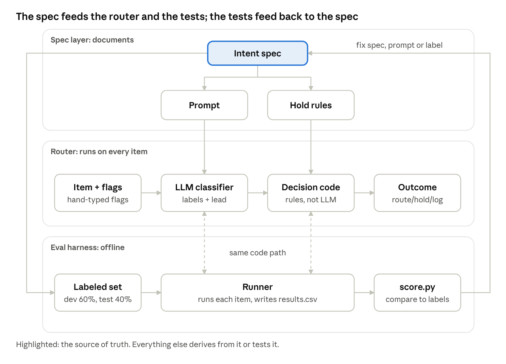
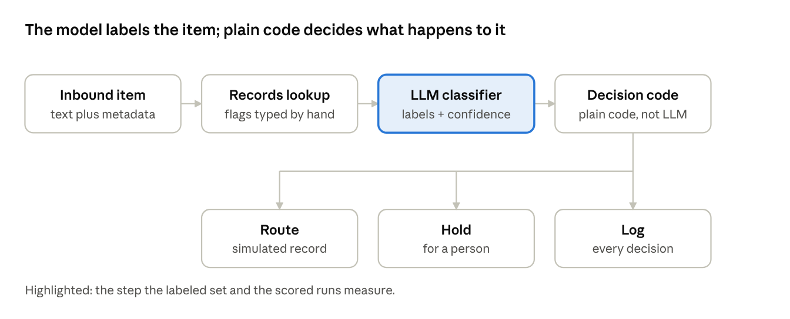

> **Synced from Claude Docs. Edit there, not here.**
> Source: [Pass 0 Build Guide](https://claude.ai/artifact/16CiqWUjxtzLMNw9B7pVM9) · doc revision 8 · synced 2026-11-04

# Pass 0 Build Guide: Construction OS Intake Router

Nov 4, 2026 · @Justin

## What we're building

Pass 0 is an intake router: it reads each inbound message or document at a general contractor and says which workflow it should start. The business term is AI intake triage; the technical term is intent classification and routing with evals.

The point is not the classifier alone. It is a classifier you can prove works: a spec that defines the intents, a labeled test set built from that spec, and a scored run that shows where it is wrong and what each mistake costs. That is the part employers and construction owners cannot get from a demo.

Pass 0 uses construction data only and stops at a label plus a simulated routing record. Fulfillment (what happens after routing), amount extraction, duplicate detection, lien-waiver checks and real OCR are later passes.

## Architecture



The spec derives the prompt, the hold rules and the labeled set. The router runs one item at a time; the offline harness calls that same code on every labeled item, and score.py's findings send you back to fix the spec, the prompt or a label.

## Where this fits in Construction OS

The router is the front door of Operations Automation. That product processes what arrives and must be tracked, with invoice intake and change capture already live. Today an item has to be pointed at the right workflow by a person; the router makes that call and holds anything it is unsure of for a person.

It fills a gap the product documents already name: document filing and routing automation is listed as not built yet. The roadmap calls Pass 0 "Construction OS's intake router."

Pitched to an owner, it is one bounded workflow, led with whichever pain he names: an admin who is behind, a missed notice, a safety record nobody can produce. That is a hypothesis to test in owner conversations, not a decision.

One design bet to keep honest: the intent catalog, hold rules and thresholds are the client-specific parts. If they stay separable from the engine, standing up a second client means rewriting the spec and relabeling a small set, not rebuilding the router. Pass 0 is the first test of that idea.

## How it works



The classifier only labels. Hold rules, the $2,500 line and the confidence floors live in decision code outside the model, so they can be tested and changed without touching the prompt.

## The pieces and where each stands

Only the spec is close to done; everything that runs is still ahead.

| Piece | What it is | Status (Nov 4) |
| --- | --- | --- |
| Intent spec v1 | Source of truth: 14 wave-1 intents, 9 deferred, 19 pair rules, precedence, hold rules, labeling instructions, eval design | Solid enough to build on; three calls still open |
| Labeled set | About 350 items planned (14 intents x 25); schema of 19 columns | About 20 items drafted; first batch needs fixes |
| Classifier prompt | Intent definitions, precedence, pair rules, output rule, record-flag and injection instructions | Draft 2; output format empty, lead rule missing |
| Record flags | has\_matching\_po, has\_exhibit\_b, authorized\_change\_exists, within\_allowance, amount\_usd | Typed by hand in Pass 0; real lookup comes later |
| classify.py | Sends each item to the Claude API with the prompt, writes labels | Not started |
| score.py | Compares output to labels: lead match, label-set match, disagreements, confusion matrix | Not started |
| Hold and decision code | Plain code outside the model: always-hold cases, the $2,500 line, confidence floors by cost tier | Defined in spec section 6; not written |
| Dataset note | One page on how the set was built and its limits | Not started |

## How we measure it

The loop is: label a set, split it, run the classifier on one half, read where it is wrong, tune, and rerun. The other half stays sealed until the end.

1. Split the labeled set 60/40 into dev and test. Tune only against dev.
2. Run the classifier on dev items, reading input columns only (never the labels).
3. Score two things: does the lead label match, and does the full label set match.
4. Read the disagreements and the confusion matrix. For each miss, decide whether the prompt, the spec or the label is wrong. The spec changes first; the prompt follows.
5. Rerun. Repeat until the misses are explained, not just fewer.
6. Run the sealed test half once. Report precision reweighted by monthly volume, because receipts are about 43% of real traffic and safety incidents about 0.3%.

A wrong guess does not cost the same in each direction. Missing a safety\_incident is far worse than over-flagging one, so the confidence floors are set by cost tier, and the 150-item routine pool is scored only for false safety\_incident and contract\_notice labels.

## Classifier prompt design

The prompt is derived from the intent spec, and the spec stays the source of truth. This section records how the prompt is built and why; the prompt text itself lives in `spec_prompt.md` in the repo. Change the spec first, then the prompt.

| Block | What it holds | Comes from |
| --- | --- | --- |
| Instructions | Role, how to classify, scoring factors, lead order, record-flag behavior, injection handling, the unsure rule | Spec labeling instructions |
| Intents | The 14 wave-1 intents: what it is, signals, rules, inputs needed | Spec intent table |
| Pair rules | The 19 boundary rules between easily confused intents | Spec pair-rule table |
| Output format | JSON fields, four rules, one worked example | Decided during the build |
| Message | Source, sender role, job stage, thread, record flags, text; placed last | Labeled-set schema |

Left out on purpose: the Handling lines and SOP numbers, the cost table, the volumes, and the hold rules, which live in decision code. The model classifies; it never holds, routes or files.

| Decision | Choice | Why |
| --- | --- | --- |
| Item id | Not in the model's output; the code attaches it | An id is plumbing, not a judgment |
| labels | A list of intent plus classification\_confidence; never empty | The scorer and decision code always have something to read |
| lead | One of the labels: precedence list (safety\_incident, then contract\_notice), then pair rules, then highest confidence | Ties in score cannot decide it |
| flags | dispute\_language, decision\_capture, outbound\_notice\_needed, backcharge; empty list when none | Same values as the labeled set's flags column |
| filing flag | Left out (open) | The spec files every item, so it would flag all of them |
| deferred\_intent | yes or no; the nine deferred intents are named in the prompt | Cannot be scored until wave 2 |
| model\_directed | Quoted text or null; scored as present or absent | Free text cannot be compared exactly |
| Hold | Never in the model's output | One owner for the decision, so errors can be traced |

Version log: v1, Nov 4, 2026. First complete draft. Not yet run.

## Repo layout and the first run

A local script in a git repo is enough. Publishing a demo online waits until a later pass.

```
intake-router/
  labeled_set.csv     exported from the workbook (scripts cannot read .numbers)
  spec_prompt.md      the classifier prompt, derived from the spec
  classify.py         calls the Claude API, one item at a time
  decide.py           hold rules and thresholds; plain code, no model call
  config.json         the $2,500 line and confidence floors
  score.py            lead match, label-set match, disagreements
  results.csv         one row per item per run, with the spec_version
  DATASET_NOTE.md     how the set was built and its limits
```

The first run is a smoke test on about 20 labeled dev items, with the sealed test half untouched. The API key lives in an environment variable. Add a `spec_version` column and a `notes` column to the set now, so every result traces back to the spec and the reason for each label.

## Build order and next steps

At about an hour a day, the aim is a first scored run, not a finished system.

1. Finish the prompt: fill in the output format, state the lead rule, strip the Handling lines and SOP numbers, fix the typos.
2. Fix the first batch in the workbook: fill INTAKE-008 and 010, correct the label typos and the 009, 013 and 014 labels, change `ambiguous` to `boundary`, add `expected_hold`.
3. Export the set to CSV and start the repo with git.
4. Write classify.py and run about 20 dev items. Bring the disagreements to the next session.
5. Sort each disagreement into prompt, spec or label error, and fix the spec first.
6. Grow the set toward 350 items, including the routine pool.
7. Write score.py with the confusion matrix, then the hold and decision code.
8. Run the sealed test half once and write the dataset note.

## Open decisions

- Receipt ingest: how receipts enter the system at all.
- Complaint log: labeling does not need it, handling does, so building\_complaint items are labeled and held for now.
- Dispute flag: does "are you going to hold this one up too?" count as dispute language?
- Deferred intents in the prompt: name the nine by definition, or accept that those items get scored separately.
- Caption-less photos: no text to read, so hold them; the rule still needs to go into the spec.
- Routine pool: keep the 150-item pool scored only for false safety\_incident and contract\_notice labels?
- Partial-payment rule (pair 11): put it in your own words.

## Ground rules for anything published

- Keep published material at architecture level: no colleague names, SYSIDs or internal URLs, and no real customer utterances.
- Nothing from Citizens goes into Pass 0, and no distinctive Citizens workbook names are reused.
- Strip SOP IDs from the spec's Handling lines before the spec leaves your workspace.
- Describe the employer as a "major U.S. bank", and check the separation agreement's confidentiality terms first.
- The spec is the source of truth. Change the spec, then the prompt, never the reverse.
